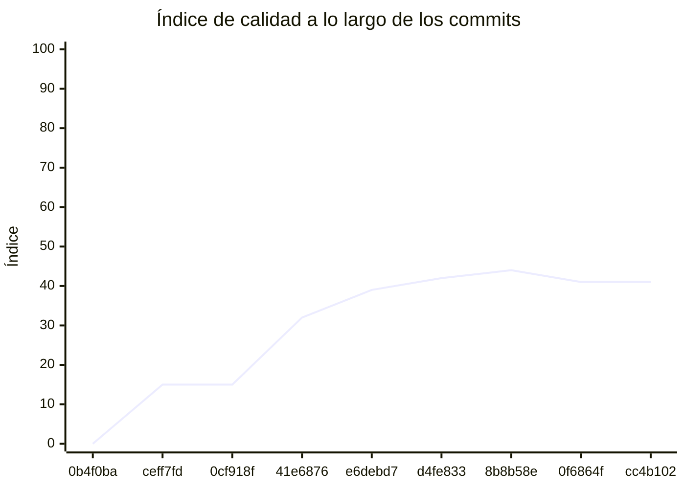

<!-- evaluacion:inicio -->
# Evaluación — prog2-perassiferrara/frontend-kmp

> Documento **generado automáticamente** por la cátedra de Programación II (UM): RepoSense + análisis de calidad de **7 dimensiones**. **No editar a mano**: se regenera en cada evaluación.
> Rama evaluada: `main`. Análisis **heurístico** (regex + métricas) + build: es una criba para orientar la revisión, **no una nota**. La **documentación** del repositorio no se evalúa.
> Generado: 2026-11-18.

## 1. Veredicto

| Aspecto | Resultado |
|---|---|
| Índice de calidad | **41/100** |
| Tipo de repositorio | `app-kmp` |
| Build (`mvnw verify` / `gradlew check`) | OK |
| Código (LOC) | 9,035 |
| Archivos de código | 80 |
| Clases | 126 |
| Código dentro de clases (%POO) | 75% |
| Funciones fuera de clases | 35 |
| Duplicación (puerta) | 8.1% |
| Duplicación lógica | 8.2% |
| Duplicación de boilerplate | 17.8% |
| Tope duro aplicado a D1 | `SUELTAS>=10` → D1 ≤ 20 |

> Este informe **describe** lo que el análisis midió con los criterios ya establecidos de la materia. No es una nota.

## 2. Semáforo de aprobación

Criterios de la cátedra (`CRITERIOS-CALIDAD.md`): **Aprobar** se juega con el perfil `estandar`; **destacar**, con el `exigente` (meta de excelencia).

| Semáforo | Resultado |
|---|---|
| Aprobar (`estandar`) | **no cumple** — 4/11 |
| Destacar (`exigente`) | **no cumple** — 4/11 |

**Para aprobar, falta cumplir:** SOLID; MVVM; Duplicación

**Para destacar, falta cumplir:** SOLID; MVVM; Duplicación

## 3. Autoría (RepoSense)

| Autor | Commits | Código (LOC) | Tests (LOC) | Docs (LOC) | Días activos | % del código |
|---|---:|---:|---:|---:|---:|---:|
| Valentino Perassi Ferrara | 22 | 9,922 | 0 | 3,519 | 7 | 100% |

> _El LOC de autoría lo calcula RepoSense sobre el historial y puede diferir del LOC de código del análisis (que mira el estado de `main`)._

## 4. Dimensiones evaluadas

Cada dimensión indica **qué mide**, **por qué importa** y **tu resultado**. Cuando el puntaje queda por debajo de la referencia, se agregan preguntas para **investigar la causa** (no hay recetas).

| Dimensión | Peso | Puntaje |
|:--|--:|--:|
| **D1** Diseño OO, SOLID y patrones (20%) | 20% | 2 |
| **D2** Arquitectura hexagonal — backend (15%) | 15% | N/A |
| **D3** Frontend KMP: MVVM y buenas prácticas (10%) | 10% | 60 |
| **D4** Integración y contrato (10%) | 10% | N/A |
| **D5** Seguridad y robustez (10%) | 10% | 95 |
| **D6** Pruebas y cobertura (20%) | 20% | 50 |
| **D7** Proceso y entrega (15%) | 15% | 31 |

### D1. Diseño OO, SOLID y patrones (20%)

- **Qué mide:** Métricas orientadas a objetos (clases, métodos, campos, cohesión, acoplamiento, herencia) y proxies de SOLID, más patrones de diseño.
- **Por qué importa:** El eje de la materia es el buen uso de la POO y su arquitectura: un diseño con clases claras y poco acopladas es más fácil de entender, probar y cambiar.
- **Tu resultado:** **2/100**
- **Para investigar la causa:**
    - ¿Se pensó el modelo de clases antes de codificar o se agrupó después?
    - ¿Qué clases concentran muchas responsabilidades a la vez?
    - ¿Los colaboradores llegan como parámetros o se crean por dentro?

### D3. Frontend KMP: MVVM y buenas prácticas (10%)

- **Qué mide:** Uso de ViewModel, estado de UI y flujo unidireccional, y ausencia de acceso a red/BD dentro de la UI.
- **Por qué importa:** Separar la UI del estado y del acceso a datos hace la app más predecible, testeable y menos propensa a bugs de ciclo de vida.
- **Tu resultado:** **60/100**

### D5. Seguridad y robustez (10%)

- **Qué mide:** Credenciales embebidas, consultas SQL por concatenación, y presencia de config de entorno; aislamiento de secretos.
- **Por qué importa:** Un secreto en el repositorio o una consulta construida por concatenación son riesgos concretos, no hipotéticos.
- **Tu resultado:** **95/100**

### D6. Pruebas y cobertura (20%)

- **Qué mide:** Cantidad y resultado de pruebas y cobertura de línea (JaCoCo/Kover, Surefire/Failsafe) cuando hay build.
- **Por qué importa:** Las pruebas son la red de seguridad para refactorizar e integrar; la cobertura acota las zonas sin verificar.
- **Tu resultado:** **50/100**
- **Para investigar la causa:**
    - ¿Qué partes del sistema no tienen pruebas?
    - ¿Las pruebas cubren caminos de error o solo el caso feliz?
    - ¿Qué falla al ejecutar la suite completa (no solo la del módulo propio)?

### D7. Proceso y entrega (15%)

- **Qué mide:** Artefactos verificables de proceso/entrega: `compose`, `.env.example`, CI (`.github/workflows/`), `CODEOWNERS` y wrapper de build (`mvnw`/`gradlew`). **No** puntúa documentación.
- **Por qué importa:** Un proyecto que compila, se levanta y se valida solo es más fácil de revisar y de integrar en equipo.
- **Tu resultado:** **31/100**
- **Para investigar la causa:**
    - ¿El proyecto se levanta con un único comando desde el repo limpio?
    - ¿Qué pasa en CI cuando se sube un cambio?
    - ¿La configuración necesaria está versionada (sin secretos)?

## 5. Señales detectadas

El análisis encontró las siguientes señales, con el archivo y la línea donde se originan cuando están disponibles:

**Archivos con más señales**

| Archivo | Señales |
|---|---:|
| `shared/src/commonMain/kotlin/com/prog2/frontend/ui/reservation/ReservationViewModel.kt` | 25 |
| `shared/src/commonMain/kotlin/com/prog2/frontend/ui/reservation/ProcessPresentation.kt` | 12 |
| `shared/src/commonMain/kotlin/com/prog2/frontend/reservation/data/KtorReservationsApi.kt` | 9 |
| `shared/src/commonMain/kotlin/com/prog2/frontend/reservation/data/ReservationsApi.kt` | 9 |
| `shared/src/commonMain/kotlin/com/prog2/frontend/ui/reservation/ReservationUiState.kt` | 9 |
| `shared/src/commonMain/kotlin/com/prog2/frontend/ui/reservation/ProcessScreen.kt` | 8 |
| `shared/src/commonMain/kotlin/com/prog2/frontend/navigation/MainScreen.kt` | 7 |
| `shared/src/commonMain/kotlin/com/prog2/frontend/ui/search/SearchScreen.kt` | 7 |
| `shared/src/commonMain/kotlin/com/prog2/frontend/ui/registration/RegistrationViewModel.kt` | 7 |
| `shared/src/commonMain/kotlin/com/prog2/frontend/session/SessionManager.kt` | 6 |

**POO** (62)
- función 'quotedUrl' fuera de una clase — `androidApp/build.gradle.kts:11`
- clase 'AppContainer' con 6 campos públicos (encapsulación) — `shared/src/androidMain/kotlin/com/prog2/frontend/config/AppContainer.kt:25`
- función 'initialCalendar' fuera de una clase — `shared/src/androidMain/kotlin/com/prog2/frontend/ui/components/AndroidDatePickerModal.kt:51`
- función 'startOfToday' fuera de una clase — `shared/src/androidMain/kotlin/com/prog2/frontend/ui/components/AndroidDatePickerModal.kt:72`
- función 'formatInstantInZone' fuera de una clase — `shared/src/androidMain/kotlin/com/prog2/frontend/ui/components/AndroidInstantFormat.kt:15`
- función 'parseInstant' fuera de una clase — `shared/src/androidMain/kotlin/com/prog2/frontend/ui/components/AndroidInstantFormat.kt:23`
- clase 'ProfessionalAvailability' con 4 campos públicos (encapsulación) — `shared/src/commonMain/kotlin/com/prog2/frontend/availability/data/AvailabilityApi.kt:9`
- clase 'AvailabilityResponse' con 4 campos públicos (encapsulación) — `shared/src/commonMain/kotlin/com/prog2/frontend/availability/data/KtorAvailabilityApi.kt:59`
- clase 'CatalogCategory' con 18 campos públicos (encapsulación) — `shared/src/commonMain/kotlin/com/prog2/frontend/catalog/data/CatalogApi.kt:6`
- clase 'Professional' con 18 campos públicos (encapsulación) — `shared/src/commonMain/kotlin/com/prog2/frontend/catalog/data/CatalogApi.kt:9`
- clase 'CatalogState' con 13 campos públicos (encapsulación) — `shared/src/commonMain/kotlin/com/prog2/frontend/catalog/data/CatalogApi.kt:21`
- clase 'ProfessionalPage' con 13 campos públicos (encapsulación) — `shared/src/commonMain/kotlin/com/prog2/frontend/catalog/data/CatalogApi.kt:24`
- clase 'ProfessionalQuery' con 7 campos públicos (encapsulación) — `shared/src/commonMain/kotlin/com/prog2/frontend/catalog/data/CatalogApi.kt:34`
- clase 'ProfessionalPageResponse' con 6 campos públicos (encapsulación) — `shared/src/commonMain/kotlin/com/prog2/frontend/catalog/data/KtorCatalogApi.kt:74`
- clase 'ProfessionalResponse' con 5 campos públicos (encapsulación) — `shared/src/commonMain/kotlin/com/prog2/frontend/catalog/data/KtorCatalogApi.kt:93`
- clase 'RegistrationRequest' con 6 campos públicos (encapsulación) — `shared/src/commonMain/kotlin/com/prog2/frontend/registration/data/KtorRegistrationApi.kt:73`
- clase 'NewAccount' con 6 campos públicos (encapsulación) — `shared/src/commonMain/kotlin/com/prog2/frontend/registration/data/RegistrationApi.kt:9`
- clase 'StartBody' con 16 campos públicos (encapsulación) — `shared/src/commonMain/kotlin/com/prog2/frontend/reservation/data/KtorReservationsApi.kt:250`
- clase 'PhoneBody' con 12 campos públicos (encapsulación) — `shared/src/commonMain/kotlin/com/prog2/frontend/reservation/data/KtorReservationsApi.kt:258`
- clase 'ProcessResponse' con 12 campos públicos (encapsulación) — `shared/src/commonMain/kotlin/com/prog2/frontend/reservation/data/KtorReservationsApi.kt:261`
- clase 'ReservationSelection' con 10 campos públicos (encapsulación) — `shared/src/commonMain/kotlin/com/prog2/frontend/reservation/data/ReservationsApi.kt:9`
- clase 'StartReservation' con 6 campos públicos (encapsulación) — `shared/src/commonMain/kotlin/com/prog2/frontend/reservation/data/ReservationsApi.kt:17`
- clase 'ReservationProcess' con 23 campos públicos (encapsulación) — `shared/src/commonMain/kotlin/com/prog2/frontend/reservation/data/ReservationsApi.kt:40`
- clase 'CancellationProgress' con 6 campos públicos (encapsulación) — `shared/src/commonMain/kotlin/com/prog2/frontend/reservation/data/ReservationsApi.kt:84`
- clase 'OwnReservationsPage' con 6 campos públicos (encapsulación) — `shared/src/commonMain/kotlin/com/prog2/frontend/reservation/data/ReservationsApi.kt:87`
- clase 'AvailabilityUiState' con 13 campos públicos (encapsulación) — `shared/src/commonMain/kotlin/com/prog2/frontend/ui/availability/AvailabilityUiState.kt:7`
- función 'isoDate' fuera de una clase — `shared/src/commonMain/kotlin/com/prog2/frontend/ui/components/DatePickerModal.kt:27`
- función 'displayDate' fuera de una clase — `shared/src/commonMain/kotlin/com/prog2/frontend/ui/components/DatePickerModal.kt:32`
- clase 'RegistrationUiState' con 13 campos públicos (encapsulación) — `shared/src/commonMain/kotlin/com/prog2/frontend/ui/registration/RegistrationUiState.kt:4`
- función 'reservationStateLabel' fuera de una clase — `shared/src/commonMain/kotlin/com/prog2/frontend/ui/reservation/MyReservationsPresentation.kt:7`
- función 'reservationProfessional' fuera de una clase — `shared/src/commonMain/kotlin/com/prog2/frontend/ui/reservation/MyReservationsPresentation.kt:16`
- función 'reservationSchedule' fuera de una clase — `shared/src/commonMain/kotlin/com/prog2/frontend/ui/reservation/MyReservationsPresentation.kt:20`
- función 'reservationCancellationNotice' fuera de una clase — `shared/src/commonMain/kotlin/com/prog2/frontend/ui/reservation/MyReservationsPresentation.kt:24`
- clase 'MyReservationsUiState' con 15 campos públicos (encapsulación) — `shared/src/commonMain/kotlin/com/prog2/frontend/ui/reservation/MyReservationsUiState.kt:9`
- función 'processReason' fuera de una clase — `shared/src/commonMain/kotlin/com/prog2/frontend/ui/reservation/ProcessPresentation.kt:59`
- función 'phoneNotice' fuera de una clase — `shared/src/commonMain/kotlin/com/prog2/frontend/ui/reservation/ProcessPresentation.kt:71`
- función 'displayTime' fuera de una clase — `shared/src/commonMain/kotlin/com/prog2/frontend/ui/reservation/ProcessPresentation.kt:84`
- función 'displayExpiration' fuera de una clase — `shared/src/commonMain/kotlin/com/prog2/frontend/ui/reservation/ProcessPresentation.kt:90`
- función 'expirationNotice' fuera de una clase — `shared/src/commonMain/kotlin/com/prog2/frontend/ui/reservation/ProcessPresentation.kt:97`
- clase 'ReservationBannerState' con 17 campos públicos (encapsulación) — `shared/src/commonMain/kotlin/com/prog2/frontend/ui/reservation/ReservationUiState.kt:34`
- clase 'ReservationUiState' con 14 campos públicos (encapsulación) — `shared/src/commonMain/kotlin/com/prog2/frontend/ui/reservation/ReservationUiState.kt:44`
- función 'start' fuera de una clase — `shared/src/commonMain/kotlin/com/prog2/frontend/ui/reservation/ReservationViewModel.kt:39`
- función 'retryStart' fuera de una clase — `shared/src/commonMain/kotlin/com/prog2/frontend/ui/reservation/ReservationViewModel.kt:55`
- función 'verify' fuera de una clase — `shared/src/commonMain/kotlin/com/prog2/frontend/ui/reservation/ReservationViewModel.kt:65`
- función 'changePhone' fuera de una clase — `shared/src/commonMain/kotlin/com/prog2/frontend/ui/reservation/ReservationViewModel.kt:73`
- función 'submitPhone' fuera de una clase — `shared/src/commonMain/kotlin/com/prog2/frontend/ui/reservation/ReservationViewModel.kt:83`
- función 'verifyPhone' fuera de una clase — `shared/src/commonMain/kotlin/com/prog2/frontend/ui/reservation/ReservationViewModel.kt:118`
- función 'refresh' fuera de una clase — `shared/src/commonMain/kotlin/com/prog2/frontend/ui/reservation/ReservationViewModel.kt:126`
- función 'present' fuera de una clase — `shared/src/commonMain/kotlin/com/prog2/frontend/ui/reservation/ReservationViewModel.kt:137`
- función 'discover' fuera de una clase — `shared/src/commonMain/kotlin/com/prog2/frontend/ui/reservation/ReservationViewModel.kt:147`
- función 'retryDiscovery' fuera de una clase — `shared/src/commonMain/kotlin/com/prog2/frontend/ui/reservation/ReservationViewModel.kt:154`
- función 'dismiss' fuera de una clase — `shared/src/commonMain/kotlin/com/prog2/frontend/ui/reservation/ReservationViewModel.kt:164`
- función 'reset' fuera de una clase — `shared/src/commonMain/kotlin/com/prog2/frontend/ui/reservation/ReservationViewModel.kt:173`
- función 'submit' fuera de una clase — `shared/src/commonMain/kotlin/com/prog2/frontend/ui/reservation/ReservationViewModel.kt:180`
- función 'onStartFailure' fuera de una clase — `shared/src/commonMain/kotlin/com/prog2/frontend/ui/reservation/ReservationViewModel.kt:204`
- función 'load' fuera de una clase — `shared/src/commonMain/kotlin/com/prog2/frontend/ui/reservation/ReservationViewModel.kt:240`
- función 'onPhoneFailure' fuera de una clase — `shared/src/commonMain/kotlin/com/prog2/frontend/ui/reservation/ReservationViewModel.kt:269`
- función 'loadPending' fuera de una clase — `shared/src/commonMain/kotlin/com/prog2/frontend/ui/reservation/ReservationViewModel.kt:294`
- función 'show' fuera de una clase — `shared/src/commonMain/kotlin/com/prog2/frontend/ui/reservation/ReservationViewModel.kt:316`
- función 'normalizePhone' fuera de una clase — `shared/src/commonMain/kotlin/com/prog2/frontend/ui/reservation/ReservationViewModel.kt:339`
- clase 'SearchUiState' con 22 campos públicos (encapsulación) — `shared/src/commonMain/kotlin/com/prog2/frontend/ui/search/SearchUiState.kt:10`
- clase 'SessionUiState' con 8 campos públicos (encapsulación) — `shared/src/commonMain/kotlin/com/prog2/frontend/ui/session/SessionUiState.kt:7`

**DIP/concretos** (66)
- clase 'MainActivity' muy acoplada (CBO=10) — `androidApp/src/main/kotlin/com/prog2/frontend/MainActivity.kt:11`
- clase 'MainActivity' instancia 5 concretos (CBO=10) — `androidApp/src/main/kotlin/com/prog2/frontend/MainActivity.kt:11`
- clase 'AppContainer' muy acoplada (CBO=20) — `shared/src/androidMain/kotlin/com/prog2/frontend/config/AppContainer.kt:25`
- clase 'AppContainer' instancia 14 concretos (CBO=20) — `shared/src/androidMain/kotlin/com/prog2/frontend/config/AppContainer.kt:25`
- clase 'AndroidEncryptedSessionStore' muy acoplada (CBO=35) — `shared/src/androidMain/kotlin/com/prog2/frontend/session/data/AndroidEncryptedSessionStore.kt:27`
- clase 'AndroidEncryptedSessionStore' instancia 12 concretos (CBO=35) — `shared/src/androidMain/kotlin/com/prog2/frontend/session/data/AndroidEncryptedSessionStore.kt:27`
- clase 'App' muy acoplada (CBO=38) — `shared/src/commonMain/kotlin/com/prog2/frontend/App.kt:60`
- clase 'App' instancia 19 concretos (CBO=38) — `shared/src/commonMain/kotlin/com/prog2/frontend/App.kt:60`
- clase 'KtorAvailabilityApi' muy acoplada (CBO=16) — `shared/src/commonMain/kotlin/com/prog2/frontend/availability/data/KtorAvailabilityApi.kt:16`
- clase 'KtorAvailabilityApi' instancia 6 concretos (CBO=16) — `shared/src/commonMain/kotlin/com/prog2/frontend/availability/data/KtorAvailabilityApi.kt:16`
- clase 'KtorCatalogApi' muy acoplada (CBO=17) — `shared/src/commonMain/kotlin/com/prog2/frontend/catalog/data/KtorCatalogApi.kt:16`
- clase 'KtorCatalogApi' instancia 5 concretos (CBO=17) — `shared/src/commonMain/kotlin/com/prog2/frontend/catalog/data/KtorCatalogApi.kt:16`
- clase 'AppDestination' muy acoplada (CBO=9) — `shared/src/commonMain/kotlin/com/prog2/frontend/navigation/AppDestination.kt:19`
- clase 'AppDestination' instancia 3 concretos (CBO=9) — `shared/src/commonMain/kotlin/com/prog2/frontend/navigation/AppDestination.kt:19`
- clase 'MainScreen' muy acoplada (CBO=43) — `shared/src/commonMain/kotlin/com/prog2/frontend/navigation/MainScreen.kt:53`
- clase 'MainScreen' instancia 21 concretos (CBO=43) — `shared/src/commonMain/kotlin/com/prog2/frontend/navigation/MainScreen.kt:53`
- clase 'ApiConfiguration' muy acoplada (CBO=9) — `shared/src/commonMain/kotlin/com/prog2/frontend/network/ApiConfiguration.kt:7`
- clase 'ApiConfiguration' instancia 3 concretos (CBO=9) — `shared/src/commonMain/kotlin/com/prog2/frontend/network/ApiConfiguration.kt:7`
- clase 'AuthenticatedApiClient' muy acoplada (CBO=18) — `shared/src/commonMain/kotlin/com/prog2/frontend/network/AuthenticatedApiClient.kt:20`
- clase 'AuthenticatedApiClient' instancia 7 concretos (CBO=18) — `shared/src/commonMain/kotlin/com/prog2/frontend/network/AuthenticatedApiClient.kt:20`
- clase 'KtorRegistrationApi' muy acoplada (CBO=19) — `shared/src/commonMain/kotlin/com/prog2/frontend/registration/data/KtorRegistrationApi.kt:21`
- clase 'KtorRegistrationApi' instancia 6 concretos (CBO=19) — `shared/src/commonMain/kotlin/com/prog2/frontend/registration/data/KtorRegistrationApi.kt:21`
- clase 'KtorReservationsApi' muy acoplada (CBO=52) — `shared/src/commonMain/kotlin/com/prog2/frontend/reservation/data/KtorReservationsApi.kt:20`
- clase 'KtorReservationsApi' instancia 7 concretos (CBO=52) — `shared/src/commonMain/kotlin/com/prog2/frontend/reservation/data/KtorReservationsApi.kt:20`
- clase 'ReservationProcess' muy acoplada (CBO=9) — `shared/src/commonMain/kotlin/com/prog2/frontend/reservation/data/ReservationsApi.kt:40`
- clase 'CancellationProgress' muy acoplada (CBO=11) — `shared/src/commonMain/kotlin/com/prog2/frontend/reservation/data/ReservationsApi.kt:84`
- clase 'OwnReservationsPage' muy acoplada (CBO=10) — `shared/src/commonMain/kotlin/com/prog2/frontend/reservation/data/ReservationsApi.kt:87`
- clase 'ReservationsApi' muy acoplada (CBO=9) — `shared/src/commonMain/kotlin/com/prog2/frontend/reservation/data/ReservationsApi.kt:97`
- clase 'JwtExpiry' muy acoplada (CBO=10) — `shared/src/commonMain/kotlin/com/prog2/frontend/session/JwtExpiry.kt:14`
- clase 'SessionError' muy acoplada (CBO=11) — `shared/src/commonMain/kotlin/com/prog2/frontend/session/SessionError.kt:4`
- clase 'SessionError' instancia 8 concretos (CBO=11) — `shared/src/commonMain/kotlin/com/prog2/frontend/session/SessionError.kt:4`
- clase 'SessionManager' muy acoplada (CBO=31) — `shared/src/commonMain/kotlin/com/prog2/frontend/session/SessionManager.kt:23`
- clase 'SessionManager' instancia 18 concretos (CBO=31) — `shared/src/commonMain/kotlin/com/prog2/frontend/session/SessionManager.kt:23`
- clase 'KtorAuthApi' muy acoplada (CBO=17) — `shared/src/commonMain/kotlin/com/prog2/frontend/session/data/KtorAuthApi.kt:18`
- clase 'KtorAuthApi' instancia 6 concretos (CBO=17) — `shared/src/commonMain/kotlin/com/prog2/frontend/session/data/KtorAuthApi.kt:18`
- clase 'AvailabilityScreen' muy acoplada (CBO=36) — `shared/src/commonMain/kotlin/com/prog2/frontend/ui/availability/AvailabilityScreen.kt:38`
- clase 'AvailabilityScreen' instancia 34 concretos (CBO=36) — `shared/src/commonMain/kotlin/com/prog2/frontend/ui/availability/AvailabilityScreen.kt:38`
- clase 'AvailabilityViewModel' muy acoplada (CBO=23) — `shared/src/commonMain/kotlin/com/prog2/frontend/ui/availability/AvailabilityViewModel.kt:19`
- clase 'AvailabilityViewModel' instancia 6 concretos (CBO=23) — `shared/src/commonMain/kotlin/com/prog2/frontend/ui/availability/AvailabilityViewModel.kt:19`
- clase 'AppBottomBar' muy acoplada (CBO=8) — `shared/src/commonMain/kotlin/com/prog2/frontend/ui/components/AppBottomBar.kt:16`
- clase 'AppBottomBar' instancia 5 concretos (CBO=8) — `shared/src/commonMain/kotlin/com/prog2/frontend/ui/components/AppBottomBar.kt:16`
- clase 'RegistrationScreen' muy acoplada (CBO=29) — `shared/src/commonMain/kotlin/com/prog2/frontend/ui/registration/RegistrationScreen.kt:27`
- clase 'RegistrationScreen' instancia 31 concretos (CBO=29) — `shared/src/commonMain/kotlin/com/prog2/frontend/ui/registration/RegistrationScreen.kt:27`
- clase 'RegistrationViewModel' muy acoplada (CBO=30) — `shared/src/commonMain/kotlin/com/prog2/frontend/ui/registration/RegistrationViewModel.kt:20`
- clase 'RegistrationViewModel' instancia 8 concretos (CBO=30) — `shared/src/commonMain/kotlin/com/prog2/frontend/ui/registration/RegistrationViewModel.kt:20`
- clase 'MyReservationsScreen' muy acoplada (CBO=37) — `shared/src/commonMain/kotlin/com/prog2/frontend/ui/reservation/MyReservationsScreen.kt:27`
- clase 'MyReservationsScreen' instancia 56 concretos (CBO=37) — `shared/src/commonMain/kotlin/com/prog2/frontend/ui/reservation/MyReservationsScreen.kt:27`
- clase 'MyReservationsViewModel' muy acoplada (CBO=24) — `shared/src/commonMain/kotlin/com/prog2/frontend/ui/reservation/MyReservationsViewModel.kt:20`
- clase 'MyReservationsViewModel' instancia 4 concretos (CBO=24) — `shared/src/commonMain/kotlin/com/prog2/frontend/ui/reservation/MyReservationsViewModel.kt:20`
- clase 'ProcessView' muy acoplada (CBO=27) — `shared/src/commonMain/kotlin/com/prog2/frontend/ui/reservation/ProcessPresentation.kt:9`
- clase 'ProcessView' instancia 11 concretos (CBO=27) — `shared/src/commonMain/kotlin/com/prog2/frontend/ui/reservation/ProcessPresentation.kt:9`
- clase 'ProcessScreen' muy acoplada (CBO=51) — `shared/src/commonMain/kotlin/com/prog2/frontend/ui/reservation/ProcessScreen.kt:29`
- clase 'ProcessScreen' instancia 69 concretos (CBO=51) — `shared/src/commonMain/kotlin/com/prog2/frontend/ui/reservation/ProcessScreen.kt:29`
- clase 'StartStatus' muy acoplada (CBO=9) — `shared/src/commonMain/kotlin/com/prog2/frontend/ui/reservation/ReservationUiState.kt:7`
- clase 'ReservationBannerState' muy acoplada (CBO=16) — `shared/src/commonMain/kotlin/com/prog2/frontend/ui/reservation/ReservationUiState.kt:34`
- clase 'ReservationBannerState' instancia 6 concretos (CBO=16) — `shared/src/commonMain/kotlin/com/prog2/frontend/ui/reservation/ReservationUiState.kt:34`
- clase 'ReservationUiState' muy acoplada (CBO=13) — `shared/src/commonMain/kotlin/com/prog2/frontend/ui/reservation/ReservationUiState.kt:44`
- clase 'ReservationUiState' instancia 5 concretos (CBO=13) — `shared/src/commonMain/kotlin/com/prog2/frontend/ui/reservation/ReservationUiState.kt:44`
- clase 'SearchScreen' muy acoplada (CBO=51) — `shared/src/commonMain/kotlin/com/prog2/frontend/ui/search/SearchScreen.kt:44`
- clase 'SearchScreen' instancia 56 concretos (CBO=51) — `shared/src/commonMain/kotlin/com/prog2/frontend/ui/search/SearchScreen.kt:44`
- clase 'SearchViewModel' muy acoplada (CBO=28) — `shared/src/commonMain/kotlin/com/prog2/frontend/ui/search/SearchViewModel.kt:21`
- clase 'SearchViewModel' instancia 6 concretos (CBO=28) — `shared/src/commonMain/kotlin/com/prog2/frontend/ui/search/SearchViewModel.kt:21`
- clase 'LoginScreen' muy acoplada (CBO=30) — `shared/src/commonMain/kotlin/com/prog2/frontend/ui/session/LoginScreen.kt:34`
- clase 'LoginScreen' instancia 24 concretos (CBO=30) — `shared/src/commonMain/kotlin/com/prog2/frontend/ui/session/LoginScreen.kt:34`
- clase 'SessionViewModel' muy acoplada (CBO=19) — `shared/src/commonMain/kotlin/com/prog2/frontend/ui/session/SessionViewModel.kt:18`
- clase 'SessionViewModel' instancia 4 concretos (CBO=19) — `shared/src/commonMain/kotlin/com/prog2/frontend/ui/session/SessionViewModel.kt:18`

**SRP/responsabilidad** (63)
- clase 'AppContainer' grande (LOC=27, métodos=0, campos=8) — `shared/src/androidMain/kotlin/com/prog2/frontend/config/AppContainer.kt:25`
- método 'AndroidEncryptedSessionStore.read' con complejidad 6 — `shared/src/androidMain/kotlin/com/prog2/frontend/session/data/AndroidEncryptedSessionStore.kt:31`
- función 'DatePickerModal' con 5 parámetros — `shared/src/androidMain/kotlin/com/prog2/frontend/ui/components/AndroidDatePickerModal.kt:21`
- método 'App.Content' de 71 líneas — `shared/src/commonMain/kotlin/com/prog2/frontend/App.kt:71`
- método 'KtorCatalogApi.searchProfessionals' con complejidad 8 — `shared/src/commonMain/kotlin/com/prog2/frontend/catalog/data/KtorCatalogApi.kt:19`
- clase 'AppDestination' sin métodos (3 campos): solo datos — `shared/src/commonMain/kotlin/com/prog2/frontend/navigation/AppDestination.kt:19`
- clase 'MainScreen' grande (LOC=248, métodos=3, campos=2) — `shared/src/commonMain/kotlin/com/prog2/frontend/navigation/MainScreen.kt:53`
- método 'MainScreen.Content' de 218 líneas — `shared/src/commonMain/kotlin/com/prog2/frontend/navigation/MainScreen.kt:55`
- método 'MainScreen.Content' con 5 parámetros — `shared/src/commonMain/kotlin/com/prog2/frontend/navigation/MainScreen.kt:55`
- método 'MainScreen.Content' con complejidad 17 — `shared/src/commonMain/kotlin/com/prog2/frontend/navigation/MainScreen.kt:55`
- método 'AuthenticatedApiClient.post' con complejidad 6 — `shared/src/commonMain/kotlin/com/prog2/frontend/network/AuthenticatedApiClient.kt:61`
- método 'KtorRegistrationApi.failureFor' con complejidad 8 — `shared/src/commonMain/kotlin/com/prog2/frontend/registration/data/KtorRegistrationApi.kt:50`
- clase 'KtorReservationsApi' grande (LOC=210, métodos=16, campos=1) — `shared/src/commonMain/kotlin/com/prog2/frontend/reservation/data/KtorReservationsApi.kt:20`
- clase 'StartBody' grande (LOC=38, métodos=1, campos=13) — `shared/src/commonMain/kotlin/com/prog2/frontend/reservation/data/KtorReservationsApi.kt:250`
- clase 'PhoneBody' grande (LOC=31, métodos=1, campos=12) — `shared/src/commonMain/kotlin/com/prog2/frontend/reservation/data/KtorReservationsApi.kt:258`
- clase 'SessionManager' grande (LOC=141, métodos=9, campos=12) — `shared/src/commonMain/kotlin/com/prog2/frontend/session/SessionManager.kt:23`
- método 'SessionManager.restore' de 31 líneas — `shared/src/commonMain/kotlin/com/prog2/frontend/session/SessionManager.kt:42`
- método 'SessionManager.restore' con complejidad 7 — `shared/src/commonMain/kotlin/com/prog2/frontend/session/SessionManager.kt:42`
- método 'SessionManager.signIn' con complejidad 6 — `shared/src/commonMain/kotlin/com/prog2/frontend/session/SessionManager.kt:79`
- método 'KtorAuthApi.authenticate' con complejidad 7 — `shared/src/commonMain/kotlin/com/prog2/frontend/session/data/KtorAuthApi.kt:22`
- método 'AvailabilityScreen.Content' de 90 líneas — `shared/src/commonMain/kotlin/com/prog2/frontend/ui/availability/AvailabilityScreen.kt:40`
- método 'AvailabilityScreen.Content' con complejidad 15 — `shared/src/commonMain/kotlin/com/prog2/frontend/ui/availability/AvailabilityScreen.kt:40`
- clase 'AvailabilityViewModel' con baja cohesión (33%) — `shared/src/commonMain/kotlin/com/prog2/frontend/ui/availability/AvailabilityViewModel.kt:19`
- función 'DatePickerModal' con 5 parámetros — `shared/src/commonMain/kotlin/com/prog2/frontend/ui/components/DatePickerModal.kt:19`
- método 'RegistrationScreen.Content' de 94 líneas — `shared/src/commonMain/kotlin/com/prog2/frontend/ui/registration/RegistrationScreen.kt:29`
- método 'RegistrationScreen.Content' con complejidad 13 — `shared/src/commonMain/kotlin/com/prog2/frontend/ui/registration/RegistrationScreen.kt:29`
- clase 'RegistrationViewModel' grande (LOC=150, métodos=14, campos=6) — `shared/src/commonMain/kotlin/com/prog2/frontend/ui/registration/RegistrationViewModel.kt:20`
- clase 'RegistrationViewModel' con baja cohesión (4%) — `shared/src/commonMain/kotlin/com/prog2/frontend/ui/registration/RegistrationViewModel.kt:20`
- método 'RegistrationViewModel.submit' de 49 líneas — `shared/src/commonMain/kotlin/com/prog2/frontend/ui/registration/RegistrationViewModel.kt:54`
- método 'RegistrationViewModel.submit' con complejidad 7 — `shared/src/commonMain/kotlin/com/prog2/frontend/ui/registration/RegistrationViewModel.kt:54`
- método 'RegistrationViewModel.showFailure' con complejidad 8 — `shared/src/commonMain/kotlin/com/prog2/frontend/ui/registration/RegistrationViewModel.kt:120`
- método 'MyReservationsScreen.Content' de 59 líneas — `shared/src/commonMain/kotlin/com/prog2/frontend/ui/reservation/MyReservationsScreen.kt:29`
- método 'MyReservationsScreen.Content' con complejidad 9 — `shared/src/commonMain/kotlin/com/prog2/frontend/ui/reservation/MyReservationsScreen.kt:29`
- método 'MyReservationsScreen.ReservationRow' de 33 líneas — `shared/src/commonMain/kotlin/com/prog2/frontend/ui/reservation/MyReservationsScreen.kt:105`
- clase 'MyReservationsViewModel' grande (LOC=143, métodos=11, campos=5) — `shared/src/commonMain/kotlin/com/prog2/frontend/ui/reservation/MyReservationsViewModel.kt:20`
- método 'MyReservationsViewModel.confirmCancellation' de 36 líneas — `shared/src/commonMain/kotlin/com/prog2/frontend/ui/reservation/MyReservationsViewModel.kt:65`
- método 'MyReservationsViewModel.confirmCancellation' con complejidad 8 — `shared/src/commonMain/kotlin/com/prog2/frontend/ui/reservation/MyReservationsViewModel.kt:65`
- método 'MyReservationsViewModel.read' de 31 líneas — `shared/src/commonMain/kotlin/com/prog2/frontend/ui/reservation/MyReservationsViewModel.kt:122`
- método 'ProcessView.processView' de 42 líneas — `shared/src/commonMain/kotlin/com/prog2/frontend/ui/reservation/ProcessPresentation.kt:15`
- clase 'ProcessScreen' grande (LOC=219, métodos=9, campos=0) — `shared/src/commonMain/kotlin/com/prog2/frontend/ui/reservation/ProcessScreen.kt:29`
- método 'ProcessScreen.Content' de 47 líneas — `shared/src/commonMain/kotlin/com/prog2/frontend/ui/reservation/ProcessScreen.kt:31`
- método 'ProcessScreen.Process' de 68 líneas — `shared/src/commonMain/kotlin/com/prog2/frontend/ui/reservation/ProcessScreen.kt:91`
- método 'ProcessScreen.Process' con complejidad 13 — `shared/src/commonMain/kotlin/com/prog2/frontend/ui/reservation/ProcessScreen.kt:91`
- método 'ProcessScreen.PhoneForm' de 38 líneas — `shared/src/commonMain/kotlin/com/prog2/frontend/ui/reservation/ProcessScreen.kt:162`
- función 'submitPhone' de 30 líneas — `shared/src/commonMain/kotlin/com/prog2/frontend/ui/reservation/ReservationViewModel.kt:83`
- función 'submitPhone' con complejidad 8 — `shared/src/commonMain/kotlin/com/prog2/frontend/ui/reservation/ReservationViewModel.kt:83`
- función 'onStartFailure' de 35 líneas — `shared/src/commonMain/kotlin/com/prog2/frontend/ui/reservation/ReservationViewModel.kt:204`
- función 'onStartFailure' con complejidad 6 — `shared/src/commonMain/kotlin/com/prog2/frontend/ui/reservation/ReservationViewModel.kt:204`
- función 'load' con complejidad 6 — `shared/src/commonMain/kotlin/com/prog2/frontend/ui/reservation/ReservationViewModel.kt:240`
- función 'loadPending' con complejidad 6 — `shared/src/commonMain/kotlin/com/prog2/frontend/ui/reservation/ReservationViewModel.kt:294`
- clase 'SearchScreen' grande (LOC=208, métodos=7, campos=0) — `shared/src/commonMain/kotlin/com/prog2/frontend/ui/search/SearchScreen.kt:44`
- método 'SearchScreen.Content' de 96 líneas — `shared/src/commonMain/kotlin/com/prog2/frontend/ui/search/SearchScreen.kt:46`
- método 'SearchScreen.Content' con complejidad 16 — `shared/src/commonMain/kotlin/com/prog2/frontend/ui/search/SearchScreen.kt:46`
- método 'SearchScreen.FilterDropdown' con 6 parámetros — `shared/src/commonMain/kotlin/com/prog2/frontend/ui/search/SearchScreen.kt:185`
- método 'SearchScreen.ProfessionalRow' de 32 líneas — `shared/src/commonMain/kotlin/com/prog2/frontend/ui/search/SearchScreen.kt:211`
- clase 'SearchViewModel' grande (LOC=143, métodos=17, campos=7) — `shared/src/commonMain/kotlin/com/prog2/frontend/ui/search/SearchViewModel.kt:21`
- clase 'SearchViewModel' con baja cohesión (18%) — `shared/src/commonMain/kotlin/com/prog2/frontend/ui/search/SearchViewModel.kt:21`
- método 'SearchViewModel.search' con complejidad 6 — `shared/src/commonMain/kotlin/com/prog2/frontend/ui/search/SearchViewModel.kt:46`
- método 'SearchViewModel.perform' de 46 líneas — `shared/src/commonMain/kotlin/com/prog2/frontend/ui/search/SearchViewModel.kt:100`
- método 'LoginScreen.Content' de 53 líneas — `shared/src/commonMain/kotlin/com/prog2/frontend/ui/session/LoginScreen.kt:36`
- método 'LoginScreen.Content' con complejidad 8 — `shared/src/commonMain/kotlin/com/prog2/frontend/ui/session/LoginScreen.kt:36`
- clase 'SessionViewModel' con baja cohesión (7%) — `shared/src/commonMain/kotlin/com/prog2/frontend/ui/session/SessionViewModel.kt:18`
- método 'SessionViewModel.signIn' con complejidad 8 — `shared/src/commonMain/kotlin/com/prog2/frontend/ui/session/SessionViewModel.kt:47`

**LSP/overrides** (8)
- 'App.Content' vacío o 'no implementado' — `shared/src/commonMain/kotlin/com/prog2/frontend/App.kt:71`
- 'MainScreen.Content' vacío o 'no implementado' — `shared/src/commonMain/kotlin/com/prog2/frontend/navigation/MainScreen.kt:55`
- 'KtorReservationsApi.startFailure' vacío o 'no implementado' — `shared/src/commonMain/kotlin/com/prog2/frontend/reservation/data/KtorReservationsApi.kt:115`
- 'AvailabilityScreen.Content' vacío o 'no implementado' — `shared/src/commonMain/kotlin/com/prog2/frontend/ui/availability/AvailabilityScreen.kt:40`
- 'MyReservationsScreen.PendingProcess' vacío o 'no implementado' — `shared/src/commonMain/kotlin/com/prog2/frontend/ui/reservation/MyReservationsScreen.kt:94`
- 'ProcessScreen.Process' vacío o 'no implementado' — `shared/src/commonMain/kotlin/com/prog2/frontend/ui/reservation/ProcessScreen.kt:91`
- 'ReservationBannerState.toString' vacío o 'no implementado' — `shared/src/commonMain/kotlin/com/prog2/frontend/ui/reservation/ReservationUiState.kt:78`
- 'ReservationUiState.toString' vacío o 'no implementado' — `shared/src/commonMain/kotlin/com/prog2/frontend/ui/reservation/ReservationUiState.kt:78`

**?** (3)
- clase 'AvailabilityException' con herencia profunda (DIT=2) — `shared/src/commonMain/kotlin/com/prog2/frontend/availability/AvailabilityError.kt:15`
- clase 'CatalogException' con herencia profunda (DIT=2) — `shared/src/commonMain/kotlin/com/prog2/frontend/catalog/CatalogError.kt:11`
- clase 'SessionException' con herencia profunda (DIT=2) — `shared/src/commonMain/kotlin/com/prog2/frontend/session/SessionError.kt:15`

**duplicación** (6)
- duplicación lógica: 8.1% · boilerplate: 17.8%
- bloque de 8 líneas repetido 5 veces en shared/src/commonMain/kotlin/com/prog2/frontend/ui/reservation/ProcessPresentation.kt:17, shared/src/commonMain/kotlin/com/prog2/frontend/ui/reservation/ProcessPresentation.kt:21, shared/src/commonMain/kotlin/com/prog2/frontend/ui/reservation/ProcessPresentation.kt:33 — `shared/src/commonMain/kotlin/com/prog2/frontend/ui/reservation/ProcessPresentation.kt:17`
- bloque de 8 líneas repetido 5 veces en shared/src/commonMain/kotlin/com/prog2/frontend/ui/reservation/ProcessPresentation.kt:18, shared/src/commonMain/kotlin/com/prog2/frontend/ui/reservation/ProcessPresentation.kt:22, shared/src/commonMain/kotlin/com/prog2/frontend/ui/reservation/ProcessPresentation.kt:34 — `shared/src/commonMain/kotlin/com/prog2/frontend/ui/reservation/ProcessPresentation.kt:18`
- bloque de 8 líneas repetido 5 veces en shared/src/commonMain/kotlin/com/prog2/frontend/ui/reservation/ProcessPresentation.kt:19, shared/src/commonMain/kotlin/com/prog2/frontend/ui/reservation/ProcessPresentation.kt:23, shared/src/commonMain/kotlin/com/prog2/frontend/ui/reservation/ProcessPresentation.kt:35 — `shared/src/commonMain/kotlin/com/prog2/frontend/ui/reservation/ProcessPresentation.kt:19`
- bloque de 8 líneas repetido 5 veces en shared/src/commonMain/kotlin/com/prog2/frontend/ui/reservation/ProcessPresentation.kt:20, shared/src/commonMain/kotlin/com/prog2/frontend/ui/reservation/ProcessPresentation.kt:24, shared/src/commonMain/kotlin/com/prog2/frontend/ui/reservation/ProcessPresentation.kt:36 — `shared/src/commonMain/kotlin/com/prog2/frontend/ui/reservation/ProcessPresentation.kt:20`
- bloque de 8 líneas repetido 4 veces en shared/src/commonTest/kotlin/com/prog2/frontend/ui/reservation/MyReservationsViewModelTest.kt:305, shared/src/commonTest/kotlin/com/prog2/frontend/ui/reservation/MyReservationsViewModelTest.kt:346, shared/src/commonTest/kotlin/com/prog2/frontend/ui/reservation/MyReservationsViewModelTest.kt:382 — `shared/src/commonTest/kotlin/com/prog2/frontend/ui/reservation/MyReservationsViewModelTest.kt:305`

**MVVM/KMP** (1)
- 1 archivo(s) de UI con red/BD dentro

## 6. Evolución por commit

Métricas calculadas sobre el estado de `main` en **cada commit** (9 commits con trabajo), del primero al último. La calidad usa el perfil `exigente`; el aporte de código lo mide RepoSense. El índice puede **bajar** al crecer el proyecto: se acumulan señales.

| # | Fecha | Commit | Autor | LOC | Índice | %POO | Duplic. | Sueltas |
|---|---|---|---|---:|---:|---:|---:|---:|
| 1 | 2026-09-07 | `0b4f0ba` | Valentino Perassi Ferrara | 0 | 0 | 0% | 0.0% | 0 |
| 2 | 2026-09-10 | `ceff7fd` | Ing. Daniel Quinteros | 0 | 15 | 0% | 0.0% | 0 |
| 3 | 2026-10-09 | `0cf918f` | Valentino Perassi Ferrara | 0 | 15 | 0% | 0.0% | 0 |
| 4 | 2026-10-31 | `41e6876` | Valentino Perassi Ferrara | 223 | 32 | 27% | 11.1% | 0 |
| 5 | 2026-11-08 | `e6debd7` | Valentino Perassi Ferrara | 2,634 | 39 | 66% | 4.3% | 1 |
| 6 | 2026-11-09 | `d4fe833` | Valentino Perassi Ferrara | 4,542 | 42 | 75% | 5.3% | 1 |
| 7 | 2026-11-09 | `8b8b58e` | Valentino Perassi Ferrara | 7,041 | 44 | 75% | 6.4% | 21 |
| 8 | 2026-11-09 | `0f6864f` | Valentino Perassi Ferrara | 8,944 | 41 | 76% | 8.4% | 35 |
| 9 | 2026-11-09 | `cc4b102` | Valentino Perassi Ferrara | 9,035 | 41 | 75% | 8.1% | 35 |

---
_Informe generado por la cátedra. Las dimensiones y umbrales corresponden a `calidad.py` (perfil `exigente`); el semáforo, a `CRITERIOS-CALIDAD.md`. La documentación del repositorio no se evalúa. Ante dudas, revisá el archivo señalado._
<!-- evaluacion:fin -->
