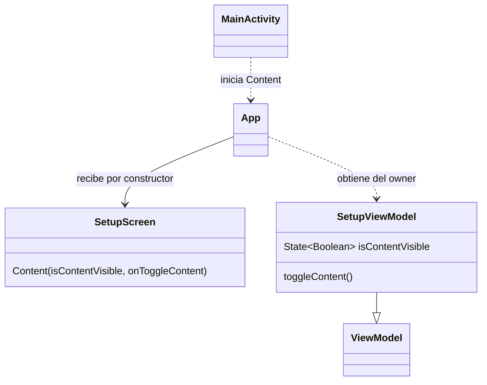

# PLAN: Base KMP ejecutable en Android

**SPEC de referencia:** [SPEC.md](SPEC.md)
**Versión de la spec revisada:** Aprobada por el usuario el 2026-10-31.
**Estado:** Aprobado <!-- Borrador | En revisión | Aprobado -->
**Aprobación:** Confirmada por el usuario el 2026-10-31.

<!-- PARA LA PERSONA
Copia esta plantilla como PLAN.md junto a la SPEC.md aprobada.
Este documento define la solución técnica. Una vez revisado, el agente puede
derivar TASKS.md con tareas, dependencias y comprobaciones.
-->

<!-- PARA EL AGENTE
- Lee la SPEC.md aprobada, las instrucciones del proyecto y MOBILE_GUIDELINES.md.
  Si falta un documento necesario o la spec no está aprobada, indícalo antes de avanzar.
- Inspecciona el repositorio. Referencia rutas verificadas y distingue las nuevas propuestas.
- Propón una solución proporcional al alcance y coherente con el proyecto.
  Reutiliza lo existente y justifica nuevas dependencias o cambios de arquitectura.
- La arquitectura KMP espera las indicaciones del profesor. Si la solución depende
  de ellas y aún faltan, registra el bloqueo de esa decisión sin inventar módulos,
  capas, librerías ni trasladar la arquitectura hexagonal de los backends.
- Distingue hechos, decisiones confirmadas y propuestas. Consulta las decisiones
  no resueltas; haz pocas preguntas por vez y actualiza el plan con las respuestas.
- Referencia los requisitos y criterios por su ID, sin copiar toda la spec.
- Si una decisión cambia el comportamiento o alcance, vuelve a la spec y solicita
  confirmación. No resuelvas una duda de producto mediante una suposición técnica.
- Conserva estos comentarios. No implementes durante la planificación.
- Solicita aprobación antes de marcar el plan como Aprobado. La autorización
  para implementar debe ser explícita; no se deduce del estado de los documentos.
- Para cambios de significado posteriores a la aprobación, registra una nota
  breve de cambio, motivo e impacto según AGENTS.md, sin historial separado.
-->

## Contexto técnico verificado

<!-- Qué existe hoy y cómo participa en la funcionalidad. -->

| Componente o archivo existente | Ruta verificada | Responsabilidad y uso previsto |
| --- | --- | --- |
| Alcance aprobado | `docs/features/setup-kmp/SPEC.md` | Seis RF y siete CA; demo mínima y descartable. |
| Reglas y guía mobile | `AGENTS.md`, `docs/GENERIC_RULES.md`, `docs/MOBILE_GUIDELINES.md` | SDD, límites del pedido y validación Android. |
| Documentación y configuración | `README.md`, `.gitignore`, `.github/CODEOWNERS`, `docs/use-cases/` | Conservar contenido y adaptar ejecución/exclusiones. |

La base del wizard sigue fuera del repositorio. Se inspeccionaron sus módulos,
versiones, manifest y demo; no se verificaron compilación ni ejecución. Hay JDK
Temurin 21, SDK API 37.0, Build Tools 36.0.0 y un AVD API 37.0 instalados, todavía
sin probar este build.

**Convenciones y patrón de referencia:** MVVM solicitado; clases con contenido
`@Composable fun Content(...)`, Version Catalog y estado observable, siguiendo lo
trabajado en clase. Las decisiones siguientes son propuestas para este setup.

## Solución propuesta

<!-- Explica el enfoque y sus motivos. Describe las responsabilidades y el
recorrido de datos y eventos hasta la interfaz. Usa un diagrama si aporta claridad. -->

Incorporar selectivamente wrapper, configuración y módulos del wizard. Reemplazar
su muestra por título `FrontendKmp`, botón y texto que aparece u oculta. Omitir
saludos, implementación de plataforma, imagen y pruebas aritméticas de ejemplo
que no intervienen en esta demo.

`MainActivity` inicia `App.Content()`. `App` recibe `SetupScreen` por constructor y
obtiene `SetupViewModel` mediante `viewModel { SetupViewModel() }`, asociado al owner
de la Activity. Entrega a la pantalla el booleano y `toggleContent()` como callback.
La pulsación cambia el estado en el ViewModel y Compose representa el resultado.
El inicializador explícito sigue la [API de ViewModel común](https://kotlinlang.org/docs/multiplatform/compose-viewmodel.html#using-viewmodel-in-common-code).



Solo se agregan las dos clases de demo. La pantalla recibe valores y acciones;
el ViewModel conserva la única copia del booleano. No hace falta un modelo de
negocio ni otra clase de estado para ese dato.

## Módulos y componentes afectados

<!-- Si el proyecto está modularizado, identifica los módulos afectados, sus
responsabilidades y la dirección de sus dependencias. Respeta los límites
existentes y justifica cualquier módulo o dependencia nueva. Si no está
modularizado, describe las carpetas o componentes afectados sin introducir
modularización fuera del alcance; marca la tabla de módulos como No aplica. -->

| Módulo | Existe / nuevo | Responsabilidad y cambios | Dependencias afectadas |
| --- | --- | --- | --- |
| `androidApp/` | Nuevo en el repo; del wizard | Activity, manifest y recursos Android. | Depende de `shared`. |
| `shared/` | Nuevo en el repo; del wizard | UI y ViewModel en `commonMain`; target Android. | Compose y Lifecycle. |

<!-- Distingue lo que se reutiliza, modifica o crea. Las rutas nuevas son propuestas.
Señala impacto sobre modelos, contratos o componentes compartidos. -->

| Componente o ruta | Acción | Cambio y responsabilidad | Requisito relacionado |
| --- | --- | --- | --- |
| Wrapper, `gradle/` y builds raíz/de módulos | Incorporar/adaptar | Build y catálogo acordados; conservar `gradlew` ejecutable. | RF-01, RF-04 |
| `androidApp/src/main/` | Incorporar/adaptar | `MainActivity` como entrada y composición; identidad y launcher. | RF-01, RF-02, RF-05 |
| `shared/src/commonMain/kotlin/com/prog2/frontend/App.kt` | Incorporar/adaptar | Clase raíz, tema Material y conexión de pantalla/estado. | RF-02 |
| `shared/src/commonMain/kotlin/com/prog2/frontend/ui/setup/` | Crear | `SetupScreen.kt` y `SetupViewModel.kt`, con las responsabilidades del diagrama. | RF-02, RF-03 |
| `README.md`, `.gitignore` | Modificar lo necesario | Requisitos/ejecución y exclusiones; preservar `docs/` y `.github/`. | RF-04, RF-06 |

Las rutas de código son destinos propuestos; aún no existen en este repositorio.
No se agregan módulos, repositorios, navegación o contenedor DI adicionales.

## Datos y contratos

<!-- Completa solo lo aplicable. Si un punto no aplica, indica el motivo. -->

- **Modelos y contratos de entrada y salida:** `isContentVisible: State<Boolean>` de solo lectura, inicialmente `false`; `toggleContent()` alterna el valor. `SetupScreen.Content` recibe `Boolean` y `() -> Unit`.
- **Backend productor, operación consumida y estado del acuerdo contractual:** no aplica; no se consume ninguna API.
- **Identificadores, relaciones y restricciones:** conservar `FrontendKmp` y `com.prog2.frontend`; sin identidades de negocio.
- **Origen de los datos mostrados y transformaciones:** texto local y booleano del ViewModel, sin mapeos remotos.
- **Persistencia, consultas y actualizaciones:** memoria del ViewModel, sin persistencia del estado demostrativo.
- **Convivencia entre datos locales y remotos:** no aplica; no existen datos remotos en este setup.
- **Compatibilidad y migraciones de datos existentes:** no aplica; no se crea almacenamiento persistente.

## Estado, operaciones y errores

<!-- Cómo se implementan los comportamientos aprobados en la spec.
Referencia RF/CA y aplica las consideraciones relevantes de MOBILE_GUIDELINES.md. -->

- **Gestión del estado de interfaz y navegación:** `mutableStateOf(false)` privado en el ViewModel, expuesto como `State<Boolean>`. Reutilizar el mecanismo visto en clase para esta acción síncrona; la UI lee el valor y entrega el callback, sin segunda copia ni navegación (RF-02, CA-02). Referencia: [estado observable](https://developer.android.com/develop/ui/compose/state#state-in-composables).
- **Conservación y restauración del estado:** el ViewModel sobrevive a recomposición, rotación y segundo plano con el owner de la Activity. Se descarta al finalizar ese owner o el proceso. No guardar el booleano en `rememberSaveable`, `SavedStateHandle` ni disco (RF-03, CA-03/04). Referencia: [ciclo de vida de ViewModel](https://developer.android.com/topic/libraries/architecture/viewmodel#lifecycle).
- **Protección de la sesión y eliminación de datos al cambiar de usuario:** no aplica; no hay sesión (RF-05).
- **Ejecución, concurrencia y cancelación de operaciones:** cambio inmediato en el hilo de UI; cada pulsación alterna el estado, sin tareas asíncronas ni efectos externos.
- **Errores, reintentos y prevención de duplicados:** no hay operaciones remotas. Diagnosticar fallos de Gradle/instalación por su causa; compilar no acredita ejecución (CA-01/02).
- **Otras consideraciones mobile aplicables y su solución:** Material predeterminado, botón con texto explícito, insets y tamaño de texto respetados; permitir desplazamiento si hace falta y ambas orientaciones. Salida normal de Android (CA-07).

## Dependencias y configuración

<!-- Librerías, servicios, permisos o configuración afectados. Verifica compatibilidad
con el proyecto y justifica las incorporaciones. No agregues dependencias por defecto. -->

Propuesta: conservar las versiones generadas salvo Material y el proveedor JDK.

| Herramienta o dependencia | Selección propuesta |
| --- | --- |
| Kotlin / Compose Compiler | 2.4.21, ambos. |
| Compose Multiplatform | 1.12.2, runtime/UI/Foundation. |
| Material | `org.jetbrains.compose.material:material:1.12.2`, estable; sustituye Material 3 `1.12.0-alpha03`. |
| ViewModel Compose | `org.jetbrains.androidx.lifecycle:lifecycle-viewmodel-compose:2.11.0`. |
| AndroidX Activity Compose | 1.13.0. |
| AGP / Gradle Wrapper | 9.1.1 / 9.5.1, preservando el checksum de distribución. |
| JDK del build / bytecode | JDK 21 / JVM 11, alineado entre módulos. |
| SDK | Mínimo 24; compile/target 37; Build Tools 36.0.0. |

Material estable resuelve esta demo y coincide con lo visto en clase. La tabla
oficial de [dependencias de Compose](https://kotlinlang.org/docs/multiplatform/whats-new-compose-112.html#dependencies)
distingue sus versiones de Material, Material 3 y Lifecycle. Los rangos oficiales
[Kotlin/Gradle/AGP](https://kotlinlang.org/docs/gradle-configure-project.html#apply-the-plugin),
[AGP/SDK/JDK](https://developer.android.com/build/releases/agp-9-1-0-release-notes#compatibility)
y [Compose/Kotlin](https://kotlinlang.org/docs/multiplatform/compose-compatibility-and-versioning.html#kotlin-compatibility)
respaldan la propuesta; build y sincronización del IDE siguen sin comprobarse.

- Mantener `toolchainVersion=21` en `gradle/gradle-daemon-jvm.properties`; quitar el requisito `AZUL` y sus URLs. Documentar JDK 21 instalado, `JAVA_HOME` y selección de JDK en Android Studio. Temurin 21 está disponible localmente. Los [criterios del daemon](https://docs.gradle.org/current/userguide/gradle_daemon.html#sec:daemon_jvm_criteria) prevalecen sobre `JAVA_HOME`; omitir vendor admite proveedores compatibles, sin rutas privadas versionadas.
- Reutilizar Version Catalog y repositorios del wizard. Incorporar dependencias utilizadas por demo/tooling, omitiendo declaraciones de ejemplo sin consumidores, incluida `lifecycle-runtime-compose` si no se usa. Sin clientes HTTP, navegación, DI ni nuevas librerías de estado.
- SDK mediante `ANDROID_HOME` o `local.properties` excluido. Conservar y comprobar las exclusiones actuales; adaptar README sin sustituirlo por el generado. Sin permisos de dispositivo, cuentas ni secretos (RF-04/05).
- Código en inglés y [KDoc](https://kotlinlang.org/docs/kotlin-doc.html) en español para responsabilidades y contratos relevantes, especialmente propiedad/duración del estado; comentarios para motivos no evidentes. Sin agregar Dokka.

## Estrategia de validación

<!-- Una fila por criterio de la spec. Selecciona el método capaz de demostrarlo:
test unitario, integración, UI o prueba manual. No todos requieren todos los métodos.
Identifica tests existentes y separa los nuevos propuestos. Incluye regresiones relevantes.
Una captura aislada no demuestra persistencia ni ausencia de peticiones de red. -->

| Criterio | Método y test existente o propuesto | Entorno y datos necesarios | Evidencia prevista |
| --- | --- | --- | --- |
| CA-01 | Wrapper, `check` y compilación debug. | JDK 21, SDK y dependencias acordadas. | Versiones efectivas, verificaciones ejecutadas y APK. |
| CA-02 | Instalar, abrir y alternar; inspeccionar MVVM. | AVD o dispositivo Android. | Secuencia observada y único origen del estado. |
| CA-03 | Mostrar, rotar e ir al fondo/regresar. | Mismo proceso, identificado por PID. | Estado conservado sin reiniciar proceso. |
| CA-04 | Mostrar, enviar al fondo, terminar proceso y reabrir tarea. | ADB o equivalente; verificar terminación y nuevo PID. | Estado inicial oculto tras muerte real del proceso. |
| CA-05 | Ejecutar sin red; revisar código, dependencias y manifest fusionado. | Demo instalada, sin conectividad. | Interacción local sin clientes/llamadas, permisos solicitados ni datos de negocio. |
| CA-06 | Comparar archivos previos y exclusiones con consultas Git de lectura. | Estado previo y cambios del setup. | Documentos/CODEOWNERS conservados; locales/build excluidos. |
| CA-07 | Reproducir README; ambas orientaciones, texto al 200 % y etiquetas. | Android Studio y AVD/dispositivo. | Comandos reproducibles, controles accesibles y contenido sin cortes. |

**Comprobaciones de regresión:** repetir arranque e interacción tras cambios de
build/UI y revisar alcance/documentación. No se proponen pruebas automatizadas
nuevas para esta demo descartable ni incorporar las dos pruebas aritméticas del
wizard como validación funcional.

**Comandos verificados para compilar y ejecutar tests:** ninguno ejecutado aún.
Los siguientes se proponen por los módulos/plugins inspeccionados; se comprobarán
al implementar y el README documentará los realmente ejecutados:

```sh
./gradlew --version
./gradlew check :androidApp:assembleDebug
./gradlew :androidApp:installDebug
adb -s <serial> shell am start -n com.prog2.frontend/.MainActivity
```

`check` es el comando general de [verificación de Gradle](https://docs.gradle.org/current/userguide/base_plugin.html#sec:base_tasks).
Comprobar qué tareas enlazan los plugins y registrar pruebas, lint y omisiones
reales; un resultado correcto sin tests no acredita pruebas funcionales.
`assembleDebug` genera el APK; instalación y arranque requieren un dispositivo
seleccionado. Windows/`gradlew.bat` no se declararán comprobados sin probarlos.

**Pruebas en dispositivo, emulador o simulador:** basta un emulador; usar el AVD
API 37.0 disponible si puede arrancarse. Rotación y muerte del proceso deben
probarse por separado; finalizar una Activity es otro caso. No declarar ejecución
en API 24 sin probarla también: build/lint solo revisan el mínimo configurado.

**Limitaciones del entorno:** la primera resolución de dependencias requiere red.
Los ensayos de ejecución necesitan un emulador o dispositivo operativo. Registrar
por separado build, pruebas y escenarios observados, dejando pendientes aquellos
sin evidencia de ejecución.

<!-- Esta sección planifica la validación. Durante la implementación, registra
en TASKS.md o en el informe de validación acordado los resultados y evidencias
reales. Usar el cierre de TASKS.md definido en AGENTS.md: CA/evidencia,
regresión y desviaciones del PLAN. Distingue comprobaciones ejecutadas,
fallidas, no ejecutadas y bloqueadas.
Compilar o tener tests en verde no sustituye revisar los criterios de la spec. -->

## Orden de implementación

<!-- Etapas y dependencias principales. El desglose ejecutable se escribe en TASKS.md.
Incluye puntos de comprobación para avanzar con cambios pequeños. -->

1. Incorporar selectivamente base y configuración; verificar wrapper/JDK y configuración de módulos.
2. Conectar `App`, pantalla y ViewModel; compilar, ejecutar y comprobar alternancia/ciclo de vida sin ampliar la demo.
3. Completar validación, README y evidencia breve en TASKS: CA, regresión y desviaciones. Antes de implementar, realizar una vez el chequeo RF/CA/PLAN/TASKS indicado en AGENTS.

## Riesgos y decisiones pendientes

<!-- Riesgos concretos de esta solución y cómo se resolverán, sin listas genéricas.
Escribe Ninguna en las decisiones pendientes cuando estén resueltas. -->

- **Riesgos y medidas acordadas:** compatibilidad práctica de plugins/SDK/IDE sin ejecutar; comprobar el build al inicio y corregir solo incompatibilidades demostradas. Evitar proveedor JDK forzado. Distinguir recreación, finalización de Activity y muerte del proceso. Mantener la demo aislada para reemplazarla.
- **Decisiones pendientes:** ninguna para este setup. Aprobados Material estable y el conjunto técnico descrito, incluidos estado Compose dentro del ViewModel y KDoc en español. HTTP, persistencia y navegación de los CU se decidirán en sus funcionalidades. La implementación requiere autorización explícita.

<!-- ANTES DE SOLICITAR APROBACIÓN
Comprueba que el plan cubre los requisitos, respeta las exclusiones, reutiliza
componentes verificados y permite demostrar todos los criterios de aceptación.
Resuelve dudas y marcadores pendientes. Si la spec cambió, revisa su impacto.
Tras aprobar el plan, deriva TASKS.md con IDs, dependencias, referencias a RF/CA
y comprobaciones. Antes de implementar, realizar el chequeo de coherencia de
AGENTS.md con esos documentos, sin otro informe ni aprobación adicional.
No marques una tarea terminada sin realizar su validación;
si está bloqueada, registra el motivo.
-->
